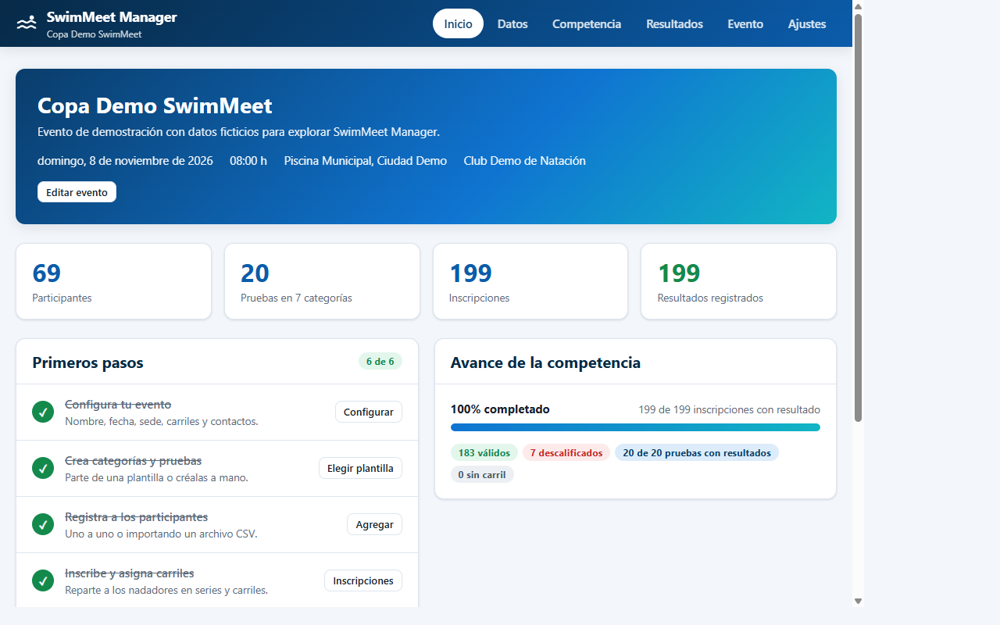
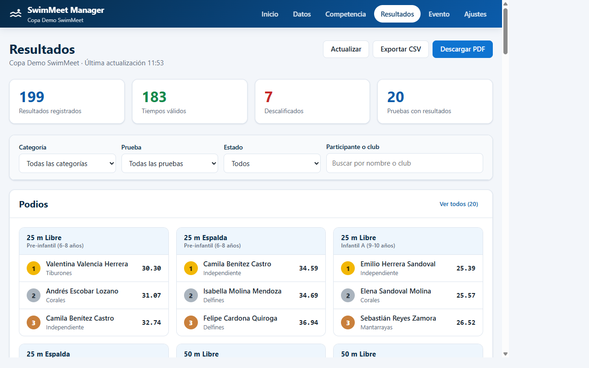

# SwimMeet Manager

Aplicación web para organizar **cualquier competencia de natación**: define tu evento, crea categorías y pruebas, inscribe participantes, reparte series y carriles, registra tiempos el día de la competencia y publica podios, tablas y PDFs.

Es una app estática (HTML, CSS y JavaScript puro, sin build ni backend): se abre con un servidor estático o desde GitHub Pages y guarda todo en el `localStorage` del navegador.



> Todos los datos de ejemplo (participantes, clubes, contactos) son **ficticios** y se generan con el botón *Cargar demo*.

## Probarla en 30 segundos

1. Sirve la carpeta (por ejemplo `python -m http.server 8000`) y abre `http://localhost:8000`.
2. En **Inicio** pulsa **Demo con resultados**.
3. Explora Datos, Competencia, Resultados y Evento. Cuando quieras empezar de cero, **Ajustes → Zona de peligro → Restablecer todo**.

## Flujo de trabajo

| Paso | Dónde | Qué haces |
|---|---|---|
| 1 | **Ajustes** | Nombre, fecha, sede, número de carriles, programa, reglas y contactos del evento |
| 2 | **Ajustes → Plantillas** o **Datos** | Categorías y pruebas a partir de una plantilla (torneo por edades, festival escolar, open) o a mano |
| 3 | **Datos** | Participantes uno a uno o **importando un CSV** (con plantilla descargable e inscripción por categoría) |
| 4 | **Competencia → Inscripciones** | Inscribes, editas carriles y **asignas series y carriles automáticamente** |
| 5 | **Competencia → Tiempos** | Capturas tiempos serie por serie (`31.52`, `31,52` o `1:05.32`) y estados OK/DQ/DNS/DNF |
| 6 | **Resultados** | Podios, tabla filtrable, **CSV** y **PDF**; ideal para proyectar o compartir |

| Datos | Competencia | Resultados |
|---|---|---|
|  |  |  |

## Características

- **Genérica**: nada está atado a un evento; nombre, sede, fecha, carriles (1–12) y piscina (25/50 m) se configuran.
- **Reglas de dominio**: un nadador no puede inscribirse dos veces en la misma prueba, un carril no puede repetirse en una serie, los tiempos se validan y las posiciones se calculan con empates (solo `OK` puntúa).
- **Integridad**: eliminar una categoría, prueba o participante elimina en cascada sus inscripciones y resultados (la interfaz avisa cuántos).
- **Copias de seguridad** en JSON, con validación estricta al importar y escritura atómica (si falla, se restaura el estado anterior).
- **PDFs** con jsPDF servido localmente (funciona sin conexión) y subida opcional a Google Drive ([guía](INSTRUCCIONES_PDF.md)).
- **Seguro por diseño**: todo el HTML dinámico pasa por una plantilla que escapa los valores, sin `innerHTML` con datos sin escapar; los CSV exportados neutralizan inyección de fórmulas.
- **Accesible y responsive**: navegación por teclado, roles ARIA en pestañas y diálogos, tablas con desplazamiento y menú móvil.

## Estructura

```
├── index.html · datos.html · competencia.html · resultados.html · evento.html · ajustes.html
├── css/        styles.css (sistema de diseño) · competencia.css · evento.css
├── js/
│   ├── database.js     Capa de datos: CRUD, validaciones, cascadas, ranking, configuración
│   ├── utils.js        html`` con escapado, tiempos, fechas, toasts, modales y diálogos
│   ├── layout.js       Cabecera, navegación y pie compartidos
│   ├── templates.js    Plantillas de categorías y pruebas
│   ├── demo.js         Evento de demostración (determinista y ficticio)
│   ├── csv.js          Lectura de CSV e importación de participantes
│   ├── export.js       Copias JSON y exportaciones CSV
│   ├── pdf.js          PDF de resultados y subida opcional a Drive
│   ├── config.js       Configuración local (URL del Apps Script)
│   └── <página>.js     Lógica de cada página
├── js/vendor/          jsPDF 2.5.1 (MIT)
├── tests/              Pruebas automáticas (node:test)
└── docs/screenshots/
```

## Pruebas

Requiere Node.js 22+ y no tiene dependencias:

```bash
npm test
```

Cubren la capa de datos (reglas, cascadas, ranking, importación/exportación atómica), utilidades (escapado, tiempos), plantillas, demo y el lector de CSV. Se ejecutan en GitHub Actions en cada push.

## Despliegue

Es un sitio estático: en GitHub, **Settings → Pages → Deploy from a branch → `main` / root**.

## Privacidad y límites

- Los datos viven solo en el navegador del equipo que los captura; para cambiar de equipo, exporta e importa una copia desde Ajustes.
- No hay cuentas, sincronización multiusuario ni servidor: está pensada para un operador por evento.
- La única comunicación externa es la subida opcional de PDFs a tu propio Apps Script.

## Licencia

[MIT](LICENSE) © 2026 Mario Andrés Jácome Mantilla. jsPDF (`js/vendor/`) se distribuye bajo su propia licencia MIT.
