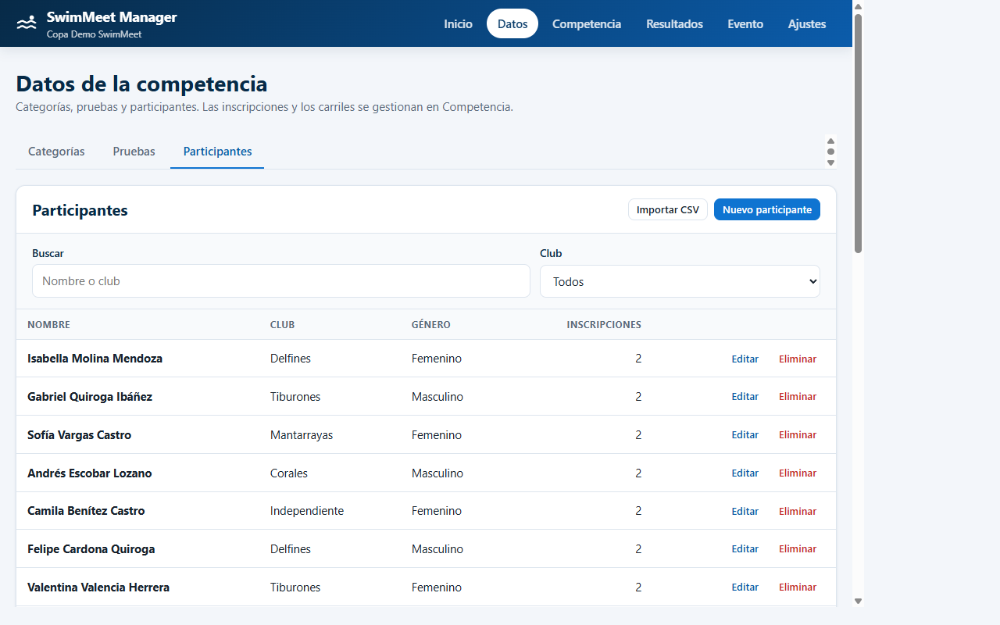
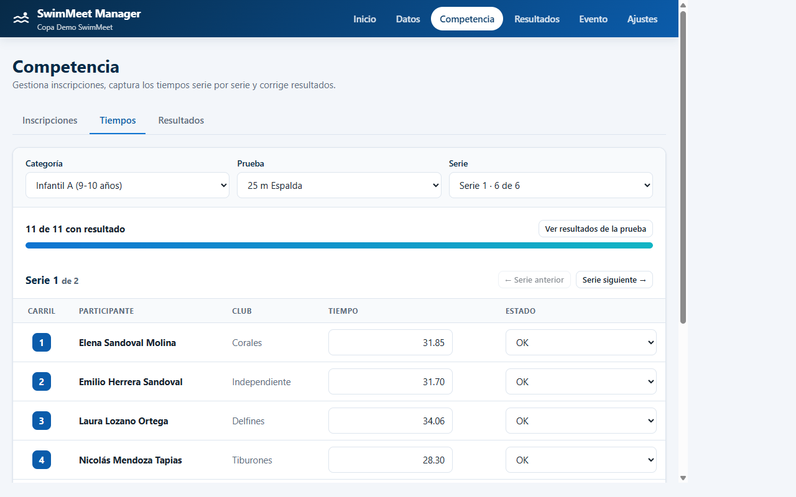
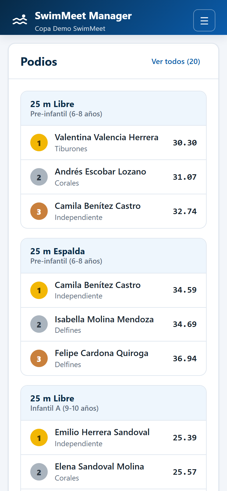

# SwimMeet Manager

Aplicación web para organizar competencias de natación, desde la configuración del evento hasta el registro de tiempos y la entrega de resultados. Usa HTML, CSS y JavaScript puro, se ejecuta desde un servidor estático y guarda los datos en el `localStorage` del navegador.


Los participantes, clubes y contactos de la demo y de las capturas son ficticios.

## Ejecutar en local

Desde la carpeta del repositorio, inicia el servidor de Python 3.

```bash
python -m http.server 8000 --bind 127.0.0.1
```

Abre **http://127.0.0.1:8000** y pulsa **Demo con resultados** en Inicio para explorar un evento ficticio. Desde Ajustes puedes restablecer los datos de la demo. La aplicación se sirve directamente desde sus archivos. Node.js se usa para las comprobaciones de desarrollo.

## Flujo de trabajo

| Paso | Dónde | Qué haces |
|---|---|---|
| 1 | **Ajustes** | Nombre, fecha, sede, número de carriles, programa, reglas y contactos del evento |
| 2 | **Ajustes → Plantillas** o **Datos** | Categorías y pruebas a partir de una plantilla (torneo por edades, festival escolar, open) o a mano |
| 3 | **Datos** | Participantes uno a uno o **importando un CSV** (con plantilla descargable e inscripción por categoría) |
| 4 | **Competencia → Inscripciones** | Inscribes, editas carriles y **asignas series y carriles automáticamente** |
| 5 | **Competencia → Tiempos** | Capturas tiempos serie por serie (`31.52`, `31,52` o `1:05.32`) y estados OK/DQ/DNS/DNF |
| 6 | **Resultados** | Podios, tabla filtrable, **CSV** y **PDF**; ideal para proyectar o compartir |

| Datos | Competencia | Resultados |
|---|---|---|
|  |  |  |



## Archivos y reglas de competencia

- La piscina puede ser de 25 o 50 m, con 1 a 12 carriles. Antes de reducir el número de carriles, reasigna o libera los que queden fuera del nuevo máximo.
- Una inscripción vincula a un participante con una prueba y puede quedar pendiente de serie y carril. Los resultados `OK` con tiempos positivos se clasifican por prueba y los empates comparten posición. Al eliminar categorías, pruebas o participantes se eliminan sus registros dependientes.
- La importación de participantes admite coma, punto y coma o tabulador. El CSV de resultados refleja los filtros activos y protege los campos de texto con prefijos de fórmula. La interpretación del CSV puede variar según la hoja de cálculo que lo abra o vuelva a guardar.
- El PDF se genera localmente con el podio completo, incluidos los empates que ocupan varias páginas. Se puede filtrar por categoría o prueba. Google Drive es opcional y viene desactivado. [Guía de PDF y Google Drive](INSTRUCCIONES_PDF.md)

## Respaldos y privacidad

- `localStorage` está ligado al protocolo, al host, al puerto y al perfil del navegador. Cambiar de puerto o perfil, borrar los datos del sitio o perder acceso al navegador puede dejar los datos inaccesibles. La aplicación está pensada para un operador por evento y una pestaña de edición.
- En **Ajustes** puedes exportar una copia JSON e importarla en otro equipo. La restauración reemplaza las secciones que incluye el archivo y valida cómo quedarían todas las relaciones y asignaciones antes de guardarlas. Si falla una escritura, la aplicación intenta revertir los cambios e informa si el navegador también impide la reversión.
- Los respaldos incluyen los contadores de identificadores. Al abrir datos de una edición anterior, cada contador empieza en el mayor identificador disponible en su colección.
- Si se detectan datos dañados, se pausa la edición y se conservan los valores originales. **Exportar copia** genera un archivo de recuperación con los valores que se pudieron leer. Ese archivo requiere revisión manual. Para reanudar la edición, importa un respaldo completo válido o confirma el restablecimiento desde Ajustes.
- Los archivos exportados pueden incluir nombres, clubes, resultados y, en el respaldo JSON, contactos del evento. Guárdalos y compártelos con el alcance adecuado.

## Estructura

```
├── index.html · datos.html · competencia.html · resultados.html · evento.html · ajustes.html
├── css/        styles.css (sistema de diseño) · competencia.css · evento.css
├── js/
│   ├── database.js     Capa de datos: CRUD, validaciones, cascadas, ranking, configuración
│   ├── utils.js        html`` con escapado, tiempos, fechas, toasts, modales y diálogos
│   ├── layout.js       Cabecera, navegación y pie compartidos
│   ├── templates.js    Plantillas de categorías y pruebas
│   ├── demo.js         Evento de demostración (determinista y ficticio)
│   ├── csv.js          Lectura de CSV e importación de participantes
│   ├── export.js       Copias JSON y exportaciones CSV
│   ├── pdf.js          PDF de resultados y subida opcional a Drive
│   ├── config.js       Configuración local (URL del Apps Script)
│   └── <página>.js     Lógica de cada página
├── js/vendor/          jsPDF 4.2.1 (MIT)
├── tests/              Pruebas automáticas (node:test)
└── docs/screenshots/
```

## Calidad automatizada

Usa **Node.js 24**.

```bash
npm ci
npm run lint
npm test
npm audit
```

Las pruebas cubren el dominio, el almacenamiento, los respaldos, CSV, PDF, utilidades, plantillas y la demo. GitHub Actions instala las dependencias de desarrollo y ejecuta ESLint y las pruebas en Linux con Node.js 24 en los pushes a `main` y las solicitudes de cambios. ESLint excluye la biblioteca de terceros.

## Licencia y autor

Mario Andrés Jácome Mantilla · [@mandresjacome](https://github.com/mandresjacome) · [Licencia MIT](LICENSE)

La copia local de jsPDF conserva sus avisos de copyright y su [licencia MIT](js/vendor/jspdf.LICENSE.txt).
